  <a href="https://withone.ai/use-cases">
    <picture>
      <source media="(prefers-color-scheme: dark)" srcset="https://raw.githubusercontent.com/withoneai/awesome-one/main/assets/banner-dark.svg">
      
    </picture>
  </a>

<h3 align="center">Awesome One</h3>

  <a href="https://withone.ai/use-cases"><strong>Use cases</strong></a>
  &nbsp;&middot;&nbsp;
  <a href="https://withone.ai/templates-vibe"><strong>Templates</strong></a>
  &nbsp;&middot;&nbsp;
  <a href="https://withone.ai/docs"><strong>Docs</strong></a>
  &nbsp;&middot;&nbsp;
  <a href="https://withone.ai/knowledge"><strong>Knowledge</strong></a>
  &nbsp;&middot;&nbsp;
  <a href="https://app.withone.ai"><strong>Dashboard</strong></a>

  
  &nbsp;
  
  &nbsp;
  

Open source agents and templates built on [One](https://withone.ai). Every entry is a working repo you can clone and run, and each one reaches its apps through&nbsp;One.

**[Start here](#start-here)** &nbsp;&middot;&nbsp; **[Agents](#agents)** &nbsp;&middot;&nbsp; **[Templates](#templates)** &nbsp;&middot;&nbsp; **[Integrations](#integrations)** &nbsp;&middot;&nbsp; **[In this repo](#in-this-repo)** &nbsp;&middot;&nbsp; **[Add yours](#add-yours)**

## Start here

Everything on this page is built with one or more of these&nbsp;four.

| Repo | What it&nbsp;is |
|---|---|
| [CLI](https://github.com/withoneai/cli) | Every app, from the terminal. A CLI built for agents to run actions, build flows, sync data and receive&nbsp;webhooks. |
| [MCP](https://github.com/withoneai/mcp) | Three tools. Every agent. Every app. One's MCP server, hosted at mcp.withone.ai or run locally from&nbsp;npm. |
| [Connect](https://github.com/withoneai/connect) | Enterprise auth for every user, for free. Embeddable authentication that lets your users connect their own apps to your product, with scoped access they can&nbsp;revoke. |
| [Knowledge](https://github.com/withoneai/knowledge) | The world's largest API knowledge base, built for&nbsp;agents. |

## Agents

Working implementations of real workflows. Each one has a page on [withone.ai/use-cases](https://withone.ai/use-cases) that walks through what it does and how to run&nbsp;it.

| Agent | What it&nbsp;does |
|---|---|
| **Go-to-market** | |
| [gtm-lead-agent](https://github.com/withoneai/gtm-lead-agent) | Research, score, and draft outreach for every inbound&nbsp;lead Exa &middot; Claude &middot; Google Sheets &middot;&nbsp;Gmail |
| [higgsfield-launch-kit](https://github.com/withoneai/higgsfield-launch-kit) | One product photo in, a launch kit out, and an agent that only pays for the shot worth&nbsp;animating Higgsfield &middot; Shopify &middot; Claude &middot; Google Drive &middot;&nbsp;Slack |
| [mastra-inbound-router](https://github.com/withoneai/mastra-inbound-router) | Route your shared inbox, and approve every move before it&nbsp;happens Mastra &middot; TypeSafe &middot; Anthropic &middot; Gmail &middot; HubSpot &middot;&nbsp;Slack |
| [speed-to-lead](https://github.com/withoneai/speed-to-lead) | Answer every new lead in minutes, with the right reply for who they&nbsp;are HubSpot &middot; Claude &middot; Gmail &middot;&nbsp;Slack |
| [winback-segment-builder](https://github.com/withoneai/winback-segment-builder) | Find the customers who bought twice and went quiet, then build the&nbsp;winback Klaviyo &middot; Shopify &middot; Claude &middot;&nbsp;Slack |
| [you-research-agent](https://github.com/withoneai/you-research-agent) | Walk into every sales call already knowing the&nbsp;account You.com &middot; Claude &middot; Slack &middot; Google&nbsp;Sheets |
| **Sales ops** | |
| [followup-debt](https://github.com/withoneai/followup-debt) | Find every promise you broke in email, and draft the&nbsp;follow-up Gmail &middot; Claude &middot;&nbsp;Slack |
| [meeting-to-crm](https://github.com/withoneai/meeting-to-crm) | Every external meeting becomes a CRM update, without opening the&nbsp;CRM Google Calendar &middot; Salesforce &middot; Claude &middot;&nbsp;Slack |
| [pipeline-hygiene-agent](https://github.com/withoneai/pipeline-hygiene-agent) | Find the deals that are lying to your pipeline&nbsp;report Salesforce &middot; Claude &middot;&nbsp;Slack |
| [renewal-risk-radar](https://github.com/withoneai/renewal-risk-radar) | Find the renewals that are slipping while you can still do&nbsp;something HubSpot &middot; Claude &middot; Gmail &middot;&nbsp;Slack |
| [target-list-builder](https://github.com/withoneai/target-list-builder) | Build the quarter's target list off a live source instead of buying a stale&nbsp;one Apify &middot; Claude &middot; HubSpot &middot; Google&nbsp;Sheets |
| [usage-to-outreach](https://github.com/withoneai/usage-to-outreach) | Find the accounts whose usage just spiked or cratered, and draft the&nbsp;outreach PostHog &middot; Stripe &middot;&nbsp;Gmail |
| **Finance** | |
| [ar-collections-agent](https://github.com/withoneai/ar-collections-agent) | Chase every overdue invoice without writing a single&nbsp;email QuickBooks &middot; Claude &middot;&nbsp;Gmail |
| [expense-policy-auditor](https://github.com/withoneai/expense-policy-auditor) | Read the month's card spend against a policy you actually wrote&nbsp;down Brex &middot; QuickBooks &middot; Claude &middot;&nbsp;Slack |
| [failed-payment-recovery](https://github.com/withoneai/failed-payment-recovery) | Recover failed payments with the email their decline reason actually&nbsp;deserves Stripe &middot; Claude &middot; Gmail &middot;&nbsp;Slack |
| [revenue-reconciler](https://github.com/withoneai/revenue-reconciler) | Match every Stripe payout to your ledger, and know why the ones that&nbsp;don't Stripe &middot; Xero &middot; Claude &middot;&nbsp;Slack |
| [vendor-renewal-watch](https://github.com/withoneai/vendor-renewal-watch) | Catch the subscriptions nobody uses before they&nbsp;renew QuickBooks &middot; Notion &middot; Claude &middot;&nbsp;Slack |
| **People operations** | |
| [candidate-screener](https://github.com/withoneai/candidate-screener) | Screen every applicant blind, with the reasoning&nbsp;attached Workable &middot; Claude &middot;&nbsp;Gmail |
| [onboarding-agent](https://github.com/withoneai/onboarding-agent) | Onboard a new hire without the four-tab&nbsp;scramble Google Sheets &middot; Google Calendar &middot; Gmail &middot;&nbsp;Slack |
| [onboarding-followthrough](https://github.com/withoneai/onboarding-followthrough) | Know what actually happened in a new hire's first two&nbsp;weeks Asana &middot; Google Calendar &middot; Claude &middot;&nbsp;Slack |
| [review-cycle-nudger](https://github.com/withoneai/review-cycle-nudger) | Chase the empty performance reviews with the goals already&nbsp;quoted Notion &middot; Claude &middot;&nbsp;Slack |
| **Operations** | |
| [backlog-groomer](https://github.com/withoneai/backlog-groomer) | Groom the Linear backlog nobody has time to go&nbsp;through Linear &middot; Claude &middot;&nbsp;Slack |
| [company-pulse](https://github.com/withoneai/company-pulse) | Wake up knowing how the company did&nbsp;yesterday Inngest &middot; Stripe &middot; Linear &middot;&nbsp;Slack |
| [deepgram-demo](https://github.com/withoneai/deepgram-demo) | Talk to your calendar, inbox and CRM, and decide exactly what the agent may&nbsp;touch Deepgram &middot; OpenAI &middot; Google Calendar &middot; Gmail &middot; Attio &middot;&nbsp;Notion |
| [doc-rot-auditor](https://github.com/withoneai/doc-rot-auditor) | Find the wiki pages that are quietly lying to your&nbsp;team Notion &middot; Claude &middot;&nbsp;Slack |
| [jev-email-classifier](https://github.com/withoneai/jev-email-classifier) | Sort your inbox into categories you write in plain&nbsp;English TypeSafe &middot;&nbsp;Gmail |
| [oncall-week-in-review](https://github.com/withoneai/oncall-week-in-review) | The on-call week in one page, with the tuning ticket already&nbsp;written Datadog &middot; Claude &middot; Linear &middot;&nbsp;Slack |
| [release-notes-writer](https://github.com/withoneai/release-notes-writer) | Turn this week's shipped tickets into release notes someone would&nbsp;read Linear &middot; Claude &middot;&nbsp;Notion |
| [shopify-store-ops](https://github.com/withoneai/shopify-store-ops) | Know what broke in your store overnight, and what to do about&nbsp;it Shopify &middot; Claude &middot;&nbsp;Slack |
| [support-signal-router](https://github.com/withoneai/support-signal-router) | Turn a week of support tickets into the three product problems behind&nbsp;them Intercom &middot; Claude &middot;&nbsp;Linear |
| **More** | |
| [competitor-radar](https://github.com/withoneai/competitor-radar) | Know what your competitors shipped before your next sales&nbsp;call Exa &middot; Claude &middot; Google Sheets &middot;&nbsp;Slack |
| [customer-360](https://github.com/withoneai/customer-360) | Find the paying customers you've gone quiet&nbsp;on Inngest &middot; Stripe &middot; Gmail &middot; Google&nbsp;Calendar |
| [funnel-triage-agent](https://github.com/withoneai/funnel-triage-agent) | Turn the funnel step that broke this week into a Linear&nbsp;ticket PostHog &middot; Claude &middot;&nbsp;Linear |
| [hermes-agent](https://github.com/withoneai/hermes-agent) | Give a self-improving agent hands on 500+&nbsp;platforms Hermes Agent &middot; Slack &middot; Gmail &middot;&nbsp;Stripe |

## Templates

Apps and pages with real integrations built in. Each one opens in Replit, Bolt.new or Lovable from the [templates&nbsp;gallery](https://withone.ai/templates-vibe).

| Template | What it&nbsp;is |
|---|---|
| **Apps** | |
| [Sales&nbsp;Agent](https://github.com/withoneai/template-sales-agent) | An AI sales teammate that works inside your users' own CRM and&nbsp;inbox. Attio &middot; HubSpot &middot; Gmail &middot;&nbsp;Resend |
| [CRM Enrichment&nbsp;Desk](https://github.com/withoneai/template-crm-enrichment-desk) | Every Attio person missing a job title, phone or LinkedIn, checked against the last email they sent&nbsp;you. Attio &middot;&nbsp;Gmail |
| [Content&nbsp;Calendar](https://github.com/withoneai/template-content-calendar) | An editorial calendar read straight from a Notion database, grouped into in progress, scheduled and&nbsp;published. Notion &middot; Google&nbsp;Calendar |
| [Support SLA&nbsp;Monitor](https://github.com/withoneai/template-support-sla-monitor) | Open Zendesk tickets ranked by how close they are to breaching&nbsp;SLA. Zendesk &middot;&nbsp;Slack |
| [Invoice&nbsp;Chaser](https://github.com/withoneai/template-invoice-chaser) | Overdue invoices read straight from Xero, each with a chase email already&nbsp;drafted. Xero &middot;&nbsp;Gmail |
| [Applicant&nbsp;Tracker](https://github.com/withoneai/template-applicant-tracker) | Inbound job applications read straight from Gmail, each one scored against the open role by Claude and logged to a Google&nbsp;Sheet. Gmail &middot; Google&nbsp;Sheets |
| [Order Ops&nbsp;Console](https://github.com/withoneai/template-order-ops-console) | Recent Shopify orders with fulfillment status, read straight from the&nbsp;store. Shopify &middot;&nbsp;Slack |
| [Bug Triage&nbsp;Desk](https://github.com/withoneai/template-bug-triage-desk) | New GitHub issues classified by severity and area, read straight from the&nbsp;repo. GitHub &middot;&nbsp;Linear |
| [Meeting Prep&nbsp;Brief](https://github.com/withoneai/template-meeting-prep-brief) | A one-page brief on every attendee before each meeting on today's calendar, read from Google Calendar and matched against HubSpot by&nbsp;email. Google Calendar &middot;&nbsp;HubSpot |
| [Standup&nbsp;Board](https://github.com/withoneai/template-standup-board) | Yesterday, today and blockers for every person, read straight from Linear and written in plain&nbsp;English. Linear &middot;&nbsp;Slack |
| [Churn&nbsp;Radar](https://github.com/withoneai/template-churn-radar) | Every account leaving your Stripe account in one view, each with a save offer already&nbsp;drafted. Stripe &middot;&nbsp;Slack |
| [Support Inbox&nbsp;Agent](https://github.com/withoneai/template-support-inbox) | A support dashboard where an agent triages your Gmail inbox, tags each message by urgency, and drafts replies you approve with one&nbsp;click. Gmail |
| [Revenue&nbsp;Dashboard](https://github.com/withoneai/template-revenue-dashboard) | A live dashboard of your Stripe revenue: MRR, new customers, and recent charges, refreshed on load with alerts posted to&nbsp;Slack. Stripe &middot;&nbsp;Slack |
| **Landing pages** | |
| [Live Pricing&nbsp;Page](https://github.com/withoneai/template-live-pricing-page) | A pricing page whose plans, prices and feature lists come straight from your Stripe&nbsp;products. Stripe |
| [Shopify Product Launch&nbsp;Page](https://github.com/withoneai/template-shopify-storefront) | A launch page that pulls live products, prices, and images straight from your Shopify store, with buy links that stay in&nbsp;sync. Shopify |
| [Waitlist Landing&nbsp;Page](https://github.com/withoneai/template-waitlist) | A polished waitlist page for your next&nbsp;launch. Google Sheets &middot;&nbsp;Slack |
| **Lead capture** | |
| [AI Lead Capture&nbsp;Form](https://github.com/withoneai/template-lead-capture) | A lead form that scores every submission with Claude against your ICP, logs it to Google Sheets, and drafts a personalized follow-up in&nbsp;Gmail. Google Sheets &middot;&nbsp;Gmail |
| [Event RSVP&nbsp;Page](https://github.com/withoneai/template-event-rsvp) | An event page where every RSVP creates a Google Calendar invite and sends a confirmation email, no ticketing platform&nbsp;needed. Google Calendar &middot;&nbsp;Gmail |

## Integrations

| Repo | What it&nbsp;is |
|---|---|
| [Mastra](https://github.com/withoneai/mastra) | `@withone/mastra`. Apps as tools, workflow steps and triggers for Mastra agents, with no OAuth code to&nbsp;write. |
| [Claude&nbsp;plugin](https://github.com/withoneai/claude-plugin) | One for Claude Code and Cowork, through One's remote MCP server. Sign in from the browser, with nothing to&nbsp;install. |
| [Agent&nbsp;plugin](https://github.com/withoneai/one-agent-plugin) | One packaged to the Agent Plugins 1.0.0 standard, which ChatGPT, Codex, Cursor, GitHub Copilot, Kiro and VS Code all read the same&nbsp;way. |
| [App&nbsp;icons](https://github.com/withoneai/app-icons) | SVG logos for every platform on&nbsp;One. |

## In this repo

Two examples live&nbsp;here.

| Example | What it&nbsp;does |
|---|---|
| [Inbox&nbsp;Run](./inbox-run/) | Gmail triage with [TypeSafe Jev](https://typesafe.ai). Jev answers four typed questions about every conversation, and One labels the mail, archives the bulk, writes a ledger and posts a&nbsp;summary. Gmail &middot; Google&nbsp;Sheets &middot; HubSpot &middot;&nbsp;Slack |
| [Prompt&nbsp;Sanitizer](./flows/prompt-sanitize/) | A One CLI flow that strips invisible text, redacts secrets and personal data, and flags prompt injection before a prompt reaches a&nbsp;model. No connections&nbsp;needed |

## Add yours

Built something on One? Open a pull request that adds a row. An entry needs three&nbsp;things.

- A public repo with a&nbsp;license.
- A README that takes a stranger to a first&nbsp;run.
- Code that works with the current One CLI, MCP server or&nbsp;API.

## Support

Email support@withone.ai or [open an&nbsp;issue](https://github.com/withoneai/awesome-one/issues).

## License

MIT. See&nbsp;[LICENSE](https://github.com/withoneai/awesome-one/blob/main/LICENSE).
